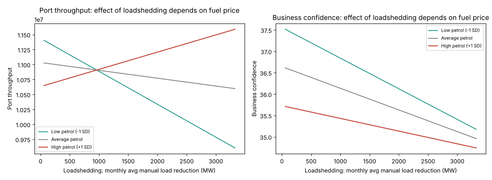
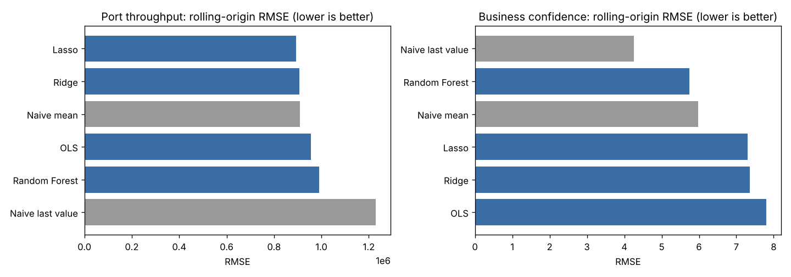

# Loadshedding, Fuel Prices and KZN Business Performance

Do loadshedding and fuel prices, taken together, help explain how KwaZulu-Natal (KZN) businesses performed between 2022 and 2025? This project builds a monthly dataset from official South African sources, compares four models (OLS, Ridge, Lasso, Random Forest) on two outcomes, and tests how far the results can be trusted.

**Short answer:** for port throughput there is a statistically significant loadshedding-by-petrol interaction that survives outlier and specification checks, but the models cannot forecast, and the same link does not appear for business confidence. The report and code say exactly where the evidence is strong and where it is thin.

Built by a four-person group for the ITDPA3 research module (Eduvos).

## Research question

What is the joint impact of loadshedding severity and fuel price volatility on KZN business performance? Firm-level data is not public, so performance is measured two ways:

- **Port throughput** at Durban and Richards Bay (estimated monthly tonnes, IMF PortWatch)
- **Business confidence** (RMB/BER Business Confidence Index, a national survey)

## Key results

| Finding | Evidence |
| --- | --- |
| Port throughput: positive loadshedding × petrol interaction | Coefficient ≈ 427,900 tonnes per SD, p ≈ 0.00001 (HAC-robust); holds when the 3 most influential months are dropped and under 4 alternative specifications |
| …but certainty is limited | Block-bootstrap 95% interval for the coefficient is about −210,000 to +774,000, with 95% of resamples positive: suggestive, not conclusive |
| The sign is not "compounding harm" | Loadshedding goes with ~16% lower throughput at cheap petrol and ~9% higher at expensive petrol (fitted model) |
| Business confidence: no matching link | Interaction p = 0.77; only the rand/dollar rate is significant (p = 0.0002) |
| Forecasting is weak | Best port-throughput model is only 3% better than the training-period average; for business confidence, carrying the last value forward is the best forecast |





The full write-up is in [`docs/evaluation_report.pdf`](docs/evaluation_report.pdf).

## Data

All inputs come from official or established public bodies: Eskom (loadshedding), DMRE (fuel prices), TNPA and IMF PortWatch (port activity), RMB/BER (business confidence), Stats SA (CPI, unemployment) and the Reserve Bank (exchange and interest rates). The repository holds the **cleaned** extracts used by the pipeline in `data/raw/`; the original downloads are not included. Check each publisher's terms before redistributing the data.

Two known gaps shape the analysis: fuel price levels are unavailable from November 2025, so models use 43 usable months (April 2022 to October 2025), and the repo rate is missing for 89% of months, so it is excluded.

## Repository layout

```
data/raw/            cleaned input extracts (three sources)
data/processed/      merged monthly dataset and merge log
src/
  merge_pipeline.py          cleaned inputs -> merged dataset
  standardized_model_suite.py  four models x two outcomes, one shared spec
  evaluation_suite.py        eight test cases, diagnostics, interpretability
results/             comparison tables, coefficients, p-values, evaluation tables
figures/             charts produced by the scripts
docs/                evaluation report (PDF)
```

## Reproduce

Python 3.10 or newer.

```bash
pip install -r requirements.txt
python src/merge_pipeline.py            # writes data/processed/
python src/standardized_model_suite.py  # writes results/ and figures/
python src/evaluation_suite.py          # writes results/eval_*.csv and figures/eval_*.png (takes about 8 minutes)
```

Run each command from the repository root. Random seeds are fixed, and a clean re-run from the included inputs reproduced every reported table; library versions can shift values at the 1e-8 level.

## Method notes

- Months stay in time order: the first 34 usable months train, the last 9 test. No shuffling.
- Features are standardised using training months only; tuning uses time-series cross-validation.
- Missing values are never imputed; petrol and diesel (r = 0.75) are not used together.
- Every model is compared with two naive benchmarks: the training-period mean and the last observed value.
- Eight test cases cover hold-out, rolling-origin, test-window length, influential months, specifications, random seeds, bootstrap and residual diagnostics.

## Limitations

One province, 34 training months, a test period with almost no loadshedding, and a port measure estimated from vessel tracking. The findings are associations for 2022 to 2025, not proof of cause and not a forecasting tool.

## Licence

Code is released under the MIT licence (see `LICENSE`).
